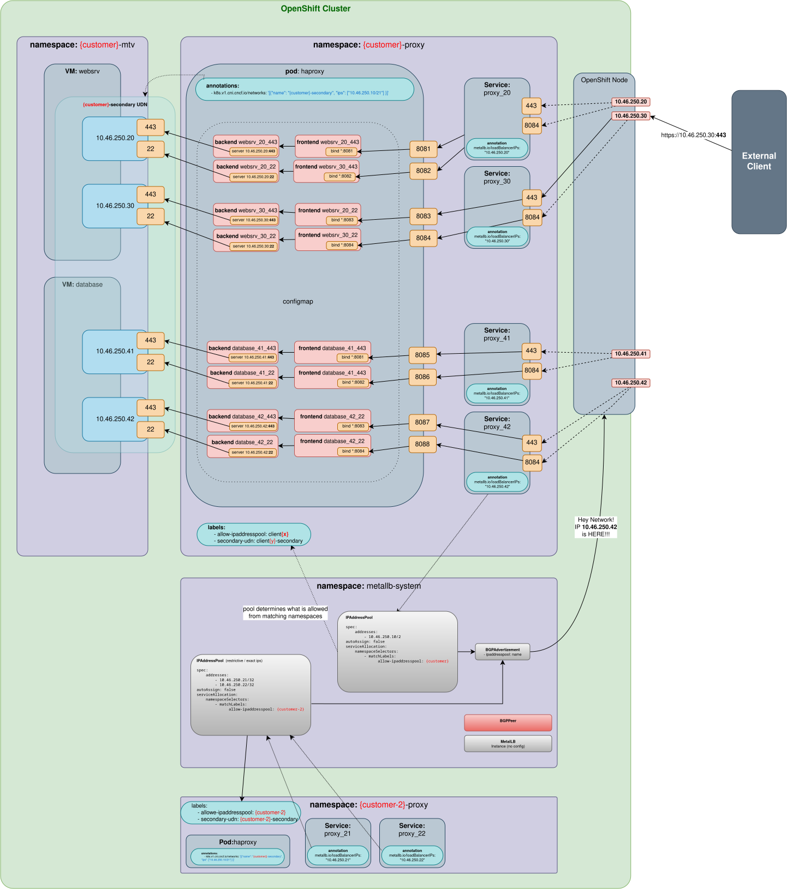

# Muli IP Workarround with Helm Templates

For the full workarround with post vm migration patch instructions for adding
the Primary UDN See: https://github.com/mathianasj/udn-two-ip-workaround

This project is a pass at wiring everything as a Helm Template to make the
process of migrating a large collection of VMs manageable.

Variables files are expected to have a `customers` variable which holds an array of customers.
Customers may be separated into separate variables files or lumped together in one file.

## Run
```shell

helm template . -f customers.yaml

```




